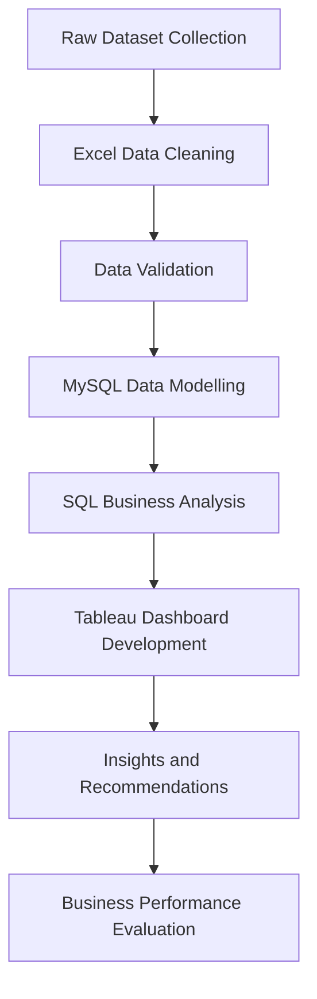

# 📊 UrbanCart – E-Commerce Sales Analytics

An end-to-end e-commerce sales analytics project analyzing sales performance, profitability, discount strategies, customer segments, payment methods, and regional trends to identify business growth opportunities and improve profitability.

<p align="left">
  
  
  
</p>

---

## 📑 Table of Contents

1. [Project Overview](#-project-overview)
2. [Business Problem](#-business-problem)
3. [Business Questions](#-business-questions)
4. [Dataset Description](#-dataset-description)
5. [Tools & Technologies](#️-tools--technologies)
6. [Project Workflow](#-project-workflow)
7. [Data Cleaning & Validation](#-data-cleaning--validation)
8. [SQL Analysis](#️-sql-analysis-mysql)
9. [Dashboard / Visualization](#-dashboard--visualization)
10. [Key Insights](#-key-insights)
11. [Business Recommendations](#-business-recommendations)
12. [Project Report](#-project-report)
13. [Conclusion](#-conclusion)
14. [Repository Structure](#-repository-structure)

---

## 📌 Project Overview

UrbanCart is an end-to-end e-commerce sales analytics project designed to evaluate business performance across multiple dimensions, including product categories, customer segments, payment methods, and geographical regions.

The project follows a complete data analytics workflow, starting with raw data cleaning and transformation in Excel, followed by relational data modelling and business analysis using MySQL, and concluding with an interactive Tableau dashboard.


## 🎯 Business Problem

UrbanCart is a mid-sized e-commerce retailer operating across Electronics, Furniture, and Clothing categories.

Despite maintaining a steady volume of orders, the business needs better visibility into its actual profitability. High sales volumes do not necessarily translate into higher profits, particularly when discounting strategies vary across product categories.

Additionally, differences in cancellation rates across payment methods, customer segments, and geographical regions raise questions about operational efficiency and business performance.

Management requires a data-driven analysis to identify profitable product categories, evaluate discount effectiveness, understand cancellation patterns, and identify underperforming regions and customer segments.

## ❓ Business Questions

The analysis addresses the following business questions:

1. **Sales & Profitability:** How are sales, profit, and profit margins performing across different product categories and sub-categories?

2. **Discount Analysis:** How do discount levels affect profitability across different product categories?

3. **Product Performance:** Which products and sub-categories contribute the most to overall sales?

4. **Customer Segmentation:** Which customer segments generate the highest sales and profitability?

5. **Payment Analysis:** Which payment methods have the highest order cancellation rates?

6. **Regional Performance:** How does sales performance vary across geographical regions?

7. **Business Growth:** How are sales and profit trends changing over time, and is profit growth keeping pace with sales growth?

## 📂 Dataset Description

**Dataset:** UrbanCart E-Commerce Sales Dataset  
**Source:** Synthetic dataset modeled on real-world e-commerce order data.
**Dataset Coverage:** 2024–2025  
**Records:** Approximately 7,000 order records  
**Structure:** Four raw data exports used for the analysis.

## 🛠️ Tools & Technologies

| Tool | Purpose |
|---|---|
| Microsoft Excel | Data cleaning, standardization, handling missing values, duplicate removal, and data preparation. |
| MySQL | Relational data modelling, star schema implementation, SQL querying, aggregations, and business analysis. |
| Tableau | Interactive dashboard development, KPI tracking, data visualization, and business performance monitoring. |

## 🔄 Project Workflow

The project follows a structured end-to-end data analytics workflow:



## 🧹 Data Cleaning & Validation

Data cleaning and preparation were performed in Microsoft Excel across all four raw data exports.

Major cleaning activities included:

- **Text Standardization:** Applied TRIM and CLEAN functions to remove unwanted spaces and non-printable characters.
- **Currency Standardization:** Removed currency symbols and converted monetary values into appropriate numerical formats.
- **Date Standardization:** Corrected mixed date formats and ensured consistent date representations.
- **Missing Values:** Identified missing values and filled or flagged them based on the context of the data.
- **Duplicate Removal:** Identified and removed duplicate records.
- **Data Validation:** Checked blank rows, inconsistent values, data types, and numerical formats.

The cleaned datasets were prepared for relational data modelling and subsequent SQL analysis.

## 🗄️ SQL Analysis (MySQL)

MySQL was used to structure the cleaned datasets into a relational database using a **Star Schema** approach.

The analysis focused on answering business questions through SQL queries involving aggregations, joins, conditional logic, subqueries, and date-based analysis.

**Key Areas of Analysis:**

1. **Sales & Profitability Analysis**
   - Total sales, total profit, and profit margin.
   - Category and sub-category performance.
   - Sales versus profit comparisons.

2. **Discount Analysis**
   - Discount levels across product categories.
   - Relationship between discounting and profit margins.
   - Identification of categories with high discounts but lower profitability.

3. **Product Performance**
   - Top-performing products by sales.
   - Sub-category contribution to overall revenue.

4. **Customer Segment Analysis**
   - Sales and profit contribution by customer segment.
   - Comparison of segment-level profitability.

5. **Payment & Cancellation Analysis**
   - Order cancellations across payment methods.
   - Identification of payment methods associated with higher cancellation rates.

6. **Regional Analysis**
   - Sales contribution across geographical regions.
   - Identification of high- and low-performing regions.

7. **Time-Based Analysis**
   - Yearly sales and profit trends.
   - Comparison of revenue growth against profit growth.
  
📁 **Explore SQL Files:**

- [Database Schema](sql/schema.sql)
- [Business Analysis Queries](sql/business_queries.sql)


## 📊 Dashboard / Visualization

An interactive e-commerce sales performance dashboard was developed using Tableau to provide management with a consolidated view of business performance.

### 📊 Dashboard Preview

<p align="center">
  
</p>


The dashboard enables users to explore business performance dynamically and identify areas requiring management attention.

📊 **View Dashboard:** 	[Tableau Dashboard](dashboard/Dashboard%20image.png)

## 💡 Key Insights

1. **Category Profitability:** Electronics generates approximately 30% profit margin, while Furniture generates only around 11% despite offering substantially higher discounts of approximately 18%.

2. **Product Contribution:** Laptops, Cameras, Headphones, and Phones account for a major share of overall revenue, significantly outperforming other sub-categories.

3. **Profit Growth:** Profit growth is lagging behind sales growth between 2024 and 2025, indicating increasing pressure on profitability.

4. **Payment Performance:** Cash on Delivery (COD) has the highest order cancellation rate, making it a clear cancellation outlier.

5. **Customer Segments:** The Consumer segment leads in sales volume, while Corporate and Home Office demonstrate comparable profit margin ratios at smaller sales volumes.

6. **Regional Performance:** North and South together contribute approximately 60% of total sales, whereas the East region contributes only around 16%.

## 🚀 Business Recommendations

1. **Optimize Discount Strategies:** Limit Furniture discounts to approximately 10%, aligning them more closely with Electronics, and reserve deeper discounts for selected clearance products.

2. **Prioritize High-Performing Products:** Allocate inventory and marketing budgets strategically toward Laptops, Cameras, Headphones, and Phones to strengthen revenue generation.

3. **Investigate Profitability Decline:** Compare category mix and discount trends between 2024 and 2025 to identify the factors responsible for profit growth lagging behind sales growth.

4. **Reduce COD Cancellations:** Evaluate COD-related cancellation patterns and introduce suitable incentives for prepaid payments, such as Card/UPI cashback, to encourage more reliable payment methods.

5. **Expand Business-to-Business Sales:** Develop targeted marketing strategies for Corporate and Home Office customers to increase their combined contribution to overall sales.

6. **Improve Regional Performance:** Investigate the East region's lower sales contribution and introduce localized promotions to improve regional performance.

## 📑 Project Report

The complete project report provides detailed documentation of the analytical process, dashboard interpretations, key findings, business recommendations, and overall conclusions.

📄 **View Full Project Report:** Refer to the project report in the repository (if uploaded).

## 🏁 Conclusion

The UrbanCart E-Commerce Sales Analytics project demonstrates an end-to-end data analytics process, from raw data preparation and relational database modelling to SQL-based business analysis and interactive dashboard development.

The analysis highlights important differences in category profitability, discount effectiveness, customer segment performance, payment-related cancellations, and regional sales contribution.

The findings provide actionable recommendations to improve discount strategies, strengthen profitable product categories, reduce cancellations, and identify opportunities for business expansion.

Overall, the project demonstrates how Excel, MySQL, and Tableau can be combined to transform raw transactional data into meaningful business insights and support data-driven decision-making.

## 📁 Repository Structure

```text
urban_cart_e-commerce_analytics/
│
├── data/
│   ├── raw/
│   └── cleaned/
│
├── excel_cleaning/
│   └── cleaning_steps.md
│
├── sql/
│   ├── schema.sql
│   └── business_queries.sql
│
├── dashboard/
│   └── Tableau Dashboard Files
│
├── insights_and_recommendations.md
│
└── README.md
```

## 👩‍💻 Author

**Riya Gupta**

🔗 **GitHub:** [riyagupta557](https://github.com/riyagupta557)

💼 **LinkedIn:** [Add LinkedIn Profile URL](YOUR_LINKEDIN_URL)

